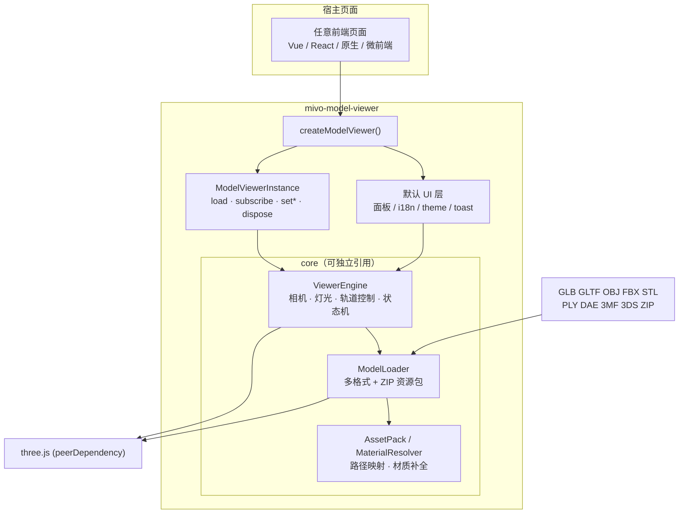

# mivo-model-viewer

**多格式 3D 模型查看器 SDK + Node CLI**：前端嵌入交互式查看器，命令行和后端处理模型信息、预览图、格式转换与优化。

浏览器 SDK 基于 TypeScript + Three.js：默认提供完整可交互 UI，也支持按面板裁剪主题，或关掉 UI 只用无头引擎自绘界面。Node CLI 无需浏览器，可用于本地处理和服务端流水线。两者由同一个 npm 包提供。

```bash
npm install mivo-model-viewer three

# 命令行（Node ≥22.12.0）
npx mivo-model-viewer --help
```

| | |
|---|---|
| npm | [`mivo-model-viewer`](https://www.npmjs.com/package/mivo-model-viewer) |
| Repository | [`xindong/modelviewer`](https://github.com/xindong/modelviewer) |
| Live Demo | GitHub Pages（本仓库 Actions 自动部署） |
| License | [MIT](LICENSE) |

---

## 为什么是它

在业务页里预览模型时，常见诉求是：

- 用户丢进来的文件格式杂（GLB / FBX / ZIP 资源包…）
- 不想为每个项目重写一套查看器 UI
- 又希望 UI 能贴合宿主产品（隐藏按钮、换主色、中英文）
- 更极端时只要 Canvas + API，界面完全自己做

`mivo-model-viewer` 把这些收成一条安装命令、一个工厂函数：

```ts
import { createModelViewer } from 'mivo-model-viewer'

const viewer = createModelViewer('#app', {
  locale: 'zh-CN',
  theme: { primary: '#745ef5' }
})

// 内置「导入」按钮即可选文件；也可程序化加载
// await viewer.load(file)
```

容器需要有明确高度：

```html
<div id="app" style="width:100%;height:100vh"></div>
```

---

## Node 后端工具 / CLI

需要 **Node ≥22.12.0**、**Three ≥0.170**。CLI 提供 `info`、`render`、`convert`、`optimize` 和 `doctor`，模型任务在隔离 Node 子进程中执行。

### 安装与运行

```bash
# 安装到当前项目，通过 npx 运行
npm install mivo-model-viewer three
npx mivo-model-viewer --help
npx mivo-model-viewer render ./model.glb -o ./preview.png

# 或全局安装，直接使用命令
npm install -g mivo-model-viewer three
mivo-model-viewer --help
mivo-model-viewer --version

# 在本仓库安装依赖后可直接运行，无需构建
npm run cli -- --help
node node/cli.mjs --help
```

以下示例使用全局命令；项目内安装时，在命令前加 `npx` 即可。

### 命令速查

| 命令 | 用途 | 示例 |
|------|------|------|
| `info` | 读取解析后的模型信息 | `mivo-model-viewer info ./model.glb --json` |
| `render` | 渲染 PNG / JPEG / WebP 预览图 | `mivo-model-viewer render ./model.glb -o ./preview.png` |
| `convert` | 将支持的模型格式或 ZIP 资源包转为自包含 GLB | `mivo-model-viewer convert ./model.fbx -o ./model.glb` |
| `optimize` | 对 GLB 减面、缩小贴图并压缩几何 | `mivo-model-viewer optimize ./model.glb -o ./model-small.glb` |
| `doctor` | 检查原生 FBX 转换器及运行兼容性 | `mivo-model-viewer doctor --json` |

每个命令均可通过 `--help` 查看完整参数，例如 `mivo-model-viewer render --help`。

### 单张与多视角出图

```bash
# 单张：默认正面、1024×1024、透视、原始材质、透明背景
mivo-model-viewer render ./model.glb -o ./preview.png

# 自定义尺寸、视角与材质模式
mivo-model-viewer render ./model.glb -o ./preview.webp \
  --width 1600 --height 900 --view left --texture-mode clay

# 多视角：只加载一次模型，输出到指定目录
mivo-model-viewer render ./model.glb \
  --views front,back,left,right,top --output-dir ./previews --size 1024
```

支持视角 `front`、`back`、`left`、`right`、`side`（等同 `left`）、`top`、`bottom`、`none`。单张使用 `-o`，多张使用 `--views` 和 `--output-dir`，两种输出方式互斥。多视角文件名为 `<模型名>-<视角>.<格式>`。

单张图片默认按输出扩展名推断格式，多张默认 PNG，可用 `--format png|jpeg|webp` 指定。JPEG 默认白底，不支持透明背景。常用参数还包括 `--projection perspective|orthographic`、`--background`、`--grid`、`--padding` 和 `--device auto|software|hardware`。

### 转换与优化

```bash
# 普通转换：不主动减面或缩小贴图
mivo-model-viewer convert ./model.fbx -o ./model.glb

# 一步转换并优化，指定减面比例、误差和贴图最大尺寸
mivo-model-viewer convert ./model.fbx -o ./model-small.glb --optimize \
  --simplify-ratio 0.5 --simplify-error 0.001 --texture-size 2048

# 对已有 GLB 优化，关闭减面并使用 Draco 几何压缩
mivo-model-viewer optimize ./model.glb -o ./model-small.glb \
  --no-simplify --compress draco

# ZIP 资源包指定入口，并增加关联资源搜索目录
mivo-model-viewer convert ./assets.zip -o ./model.glb \
  --entry models/model.obj --resource-dir ./textures
```

优化可能改变节点层级与模型细节。默认减面目标比例为 `0`、误差为 `0.0001`，表示在误差约束内尽量简化；`--simplify-ratio 0.5` 是目标比例，不保证固定保留一半面数。默认贴图最大尺寸为 `2048`、贴图压缩为 `auto`、几何压缩为 `meshopt`。可用 `--no-simplify` 关闭减面，`--compress meshopt|draco|quantize|none` 选择几何压缩。`convert` 的优化参数需配合 `--optimize` 使用。

### 公共参数与脚本集成

| 参数 | 说明 |
|------|------|
| `--json` | stdout 输出一个 JSON 结果，日志和进度走 stderr |
| `--timeout <seconds>` | 任务超时，默认 120 秒 |
| `--resource-dir <path>` | 增加关联资源搜索目录，可重复传入 |
| `--entry <path>` | 指定 ZIP 内的模型入口 |
| `--strict` | 将适用的保真警告视为错误 |
| `--allow-network` | 允许读取公共 HTTP(S) 关联资源，默认关闭 |
| `--overwrite` | 允许替换已有输出文件，默认不覆盖 |
| `--fbx-backend native|three` | 选择 Node FBX 后端，默认 `native` |
| `--fbx-binary <path>` | 指定原生 FBX 转换器的可执行文件 |

```bash
mivo-model-viewer info ./model.glb --json > ./model-info.json
mivo-model-viewer convert ./model.fbx -o ./model.glb --json > ./convert-result.json
```

模型任务的 JSON 结果包含 `schemaVersion`、`ok`、`command`、`input`、`entry`、`outputs`、`data`、`warnings`、`error`。CLI 的 `outputs` 返回输出文件绝对路径和 `byteLength`；`data.timings` 提供处理耗时（毫秒）。退出码：`0` 成功、`1` 运行失败、`2` 参数错误、`130` 中断。

### Node API

后端直接调用（模型任务在隔离 Node 子进程中执行）：

```js
import { createModelProcessor } from 'mivo-model-viewer/node'
import { writeFile } from 'node:fs/promises'

const processor = createModelProcessor({ concurrency: 1, maxQueue: 32 })
try {
  const result = await processor.convertModelToGlb('/data/model.fbx', {
    optimize: true,
    simplifyRatio: 0.5,
    timeout: 120
  })
  await writeFile('/data/model-small.glb', result.outputs[0].bytes)
} finally {
  await processor.close()
}
```

### 常驻模型预览 API

`createModelPreviewProcessor(options?)` 专用于高频预览，返回 `{ renderModelImages, close }`。
每个实例按需启动一个常驻隔离 worker，串行执行任务，复用模型准备缓存和 GPU；原有
`createModelProcessor`、独立 Node 方法和 CLI 保持原有行为。loader、GPU 与进程清理实现位于
独立的 `node/preview/`，基础校验、资源解析、像素处理、设备选择、进程清理与原生 FBX 转换
复用 `node/` 公共实现。导入 Node 入口不会在宿主进程初始化图形设备。

```js
import { createModelPreviewProcessor } from 'mivo-model-viewer/node'
import { readFile, writeFile } from 'node:fs/promises'

const processor = createModelPreviewProcessor({
  maxQueue: 32,
  maxTasks: 64,
  maxRssBytes: 1024 ** 3,
  cacheEntries: 4,
  cacheBytes: 64 * 1024 ** 2,
  gpuPixels: 4 * 1024 ** 2,
  idleMs: 60_000
})
try {
  // 字节输入支持准备结果缓存；同样支持本地路径和 ZIP 资源包。
  const source = { bytes: await readFile('/data/model.glb'), fileName: 'model.glb' }
  const controller = new AbortController()
  const result = await processor.renderModelImages(source, {
    timeout: 120, // 可省略，默认 120 秒；包含排队、进程启动和执行时间
    width: 512,
    height: 512,
    views: ['front', 'side', 'top'],
    signal: controller.signal,
    onProgress: message => console.log(message)
  })
  for (const output of result.outputs) {
    await writeFile(`/data/${output.name}`, output.bytes)
  }
  console.log(result.data.timings)
} finally {
  await processor.close()
}
```

池预算（每个实例独立，均为安全整数）：

| 选项 | 默认值 | 行为 |
|------|--------|------|
| `maxQueue` | `32` | 等待队列上限，不含正在执行的任务；满时拒绝并返回 `QUEUE_FULL`，`0` 禁止排队 |
| `maxTasks` | `64` | worker 完成指定任务数后回收，必须大于 0 |
| `maxRssBytes` | `1 GiB` | 每次任务结束后检查 RSS，达到预算回收 worker，必须大于 0；不是执行期间的硬内存上限 |
| `cacheEntries` | `4` | 内存 LRU 最多保留的准备结果数，`0` 禁用缓存 |
| `cacheBytes` | `64 MiB` | 缓存 GLB 字节和诊断文本的预算；不包含全部 JS/GPU 开销，`0` 不保留准备结果 |
| `gpuPixels` | `4,194,304` | 可常驻 GPU 渲染目标的最大像素数（宽 × 高），`0` 禁止复用 |
| `idleMs` | `60,000` | 空闲回收时间（毫秒），`0` 禁用空闲回收 |

使用 `AbortSignal` 取消：排队任务直接移除；运行中的任务会终止并回收整个 worker，
POSIX 系统同时终止进程组中的 native FBX 子进程，清理完成后才结束该任务。超时采用相同回收机制，
返回 `TIMEOUT`。任务错误也会回收 worker，后续任务按需创建新进程；清理失败时池停止接收任务。
`close()` 可重复调用，会拒绝等待及运行中的任务，并等待进程和临时文件清理；关闭后调用返回
`PREVIEW_DISPOSED`。预览 API 固定禁用网络。`signal` 和 `onProgress` 留在父进程，
不放入 IPC；worker 的带任务 ID 的进度消息会转发给当前任务的 `onProgress`，回调抛错不会中断渲染。

缓存只保存在 worker 内存中，只缓存成功渲染过的准备 GLB 与诊断信息，不缓存最终图片。
缓存键包含输入字节、文件名、资源字节，以及影响模型准备的加载参数（归档入口、FBX 后端、
模型变换、纹理解码限制、STEP 参数、资源预算和保真约束等）。尺寸、视角、投影、材质显示、
灯光、设备、图片编码和超时不参与准备缓存键，因此 thumbnail/detail 可以共享准备结果。
路径输入、指定 `resourceDirs` 或
`fbxBinary` 的任务不缓存准备结果，避免复用已变化的外部文件。回收 worker 会清空缓存。
未压缩且没有外部资源的 GLB 可以直接进入渲染快速路径，其余输入走完整准备流程。

worker 最多保留一个 GPU 设备与渲染目标；设备选择一致且像素数在预算内时复用，尺寸变化会调整目标。
超出 `gpuPixels` 的任务仍可渲染，但使用临时设备，任务完成后释放，同时丢弃原有常驻设备。
模型场景和临时资源每次任务都会清理。

成功结果类型为 `PreviewResult`，包含 `ok`、`outputs`、`warnings`、`data.timings` 和
`data.render`，没有旧 `ModelResult` 的 `schemaVersion`、`command`、`input`、`entry`、`error` 字段。
`PreviewRenderOptions` 整体可省略；超时默认值来自标准 `validateOptions`，为 120 秒，
显式超时范围为 `(0, 86400]` 秒。渲染选项在入队前校验并标准化，worker 会再次校验。
附加耗时字段为 `startupMs`、`prepareMs`、`gpuInitMs`、`gpuResizeMs`，附加状态字段为
`cacheHit`、`fastPath`、`gpuReused`；公共 `ModelTimings` 将这些字段声明为可选，以兼容旧 API。
预览结果使用 `PreviewTimings`，不要求旧处理器的 `executionMs`；各阶段未执行时可能为 `null`。
`queueMs`、`workerMs`、`totalMs` 均为毫秒且可能覆盖其他阶段，不应直接相加。

### 原生 FBX 转换与运行环境

Node 的 FBX 默认使用依赖内的 FBX2glTF，不需要全局安装转换器。
文件、字节和 ZIP 内 FBX 的 `convert`、`info`、`render` 使用同一原生加载流程。

```bash
mivo-model-viewer doctor --json
mivo-model-viewer convert ./model.fbx -o ./model.glb --json
# 显式使用旧 Three.js 后端，或指定自有可执行文件
mivo-model-viewer convert ./model.fbx -o ./model.glb --fbx-backend three
mivo-model-viewer doctor --fbx-binary /absolute/path/FBX2glTF --json
```

Node API 对应 `fbxBackend: 'native' | 'three'`、`fbxBinary`。
原生失败不会自动回退；`onlyVisible: true` 需显式使用 `three`。
明确验收环境为 macOS ARM64 + Rosetta（运行 x64 二进制）和 Ubuntu x64/glibc。
SDK 不自动安装 Rosetta，不承诺 Windows、Linux ARM64 或 Alpine/musl。

原生结果提供实际后端、版本和 `data.timings.nativeConversionMs`，
该耗时只计原生子进程，不等于 SDK 总耗时。
缺失纹理会报告警告，`--strict` 拒绝；图片数量一致不代表找回真实纹理。
父进程负责清理任务进程组和临时目录，关闭 processor 时须 `await processor.close()`。
依赖的第三方许可和 Autodesk 声明见 `THIRD_PARTY_FBX2GLTF_LICENSE.txt`。
浏览器端 FBX 加载不受此 Node 默认后端变更影响。

**渲染依赖**：Node Dawn/WebGPU + Three.js，macOS 使用 Metal；Linux 无 GPU 使用 Mesa Lavapipe 软件 Vulkan，需要系统 `libvulkan1`、`mesa-vulkan-drivers`。提供 `Dockerfile.node`，不使用 Chromium、Python 或 Blender。info/GLB 转换/优化不初始化图形设备。

详见 [CLI 设计与部署说明](docs/cli-design.md)。测试使用 `npm run test:node`，不包含 SDK 构建或类型检查。

Node CLI/API 的结果自动提供 `data.timings`（毫秒）：模型加载与转换、GLB 导出、完整优化、纯减面、渲染、排队及任务总时间；CLI 另有文件写入和命令总时间。优化各阶段明细位于 `data.optimization.stageTimingsMs`。字段口径及独立基准测量说明见 `docs/cli-design.md`。

---

## 支持格式

| 类型 | 格式 | 说明 |
|------|------|------|
| 模型 | **GLB / GLTF / OBJ / FBX / STL / PLY / DAE / 3MF / 3DS** | 浏览器内直接解析 |
| 资源包 | **ZIP** | 内含模型 + 贴图时自动选入口、映射路径 |
| 实验性 | **VRML**（`.wrl` / `.vrml`） | three.js `VRMLLoader` 简单展示，复杂节点可能丢失 |
| 实验性 | **STEP**（`.step` / `.stp`） | `occt-import-js` WASM 细分网格预览，非完整 CAD |
| 暂不作为生产路径 | 工业级 CAD 还原 | 建议转 GLB/OBJ 再导入 |

### 实验性 VRML / STEP

仅保证「能打开看个大概形状」，**不承诺** B-Rep 精度、装配约束、PMI、任意 VRML 节点。

```bash
# STEP 需要可选依赖
npm install mivo-model-viewer three occt-import-js
```

```ts
import { setStepWasmUrl } from 'mivo-model-viewer/core'

// 可选：自托管 WASM（默认用 unpkg CDN）
// setStepWasmUrl('/occt-import-js.wasm')
```

- 通过 UI「导入」或 `load(file)` / `createModelViewer({ src: file })` 使用  
- 材质栏会显示「实验性展示」  
- 管线/大装配仍建议服务端转 GLB 后交给本 SDK

**ZIP + 材质策略（明确边界）**

1. 解压 ZIP → 自动选入口模型（浅路径优先，glb/gltf > fbx > obj > 3ds…）
2. LoadingManager 把相对路径映射到包内资源（`textures/`、`fbm/`、同目录等）
3. FBX / OBJ / 3DS / DAE：Loader 缺贴图时按 basename + 关键词（diffuse / normal / rough / metal…）补全
4. OBJ 尝试解析包内简易 MTL（Kd / map_Kd）
5. 仍缺失：回落默认 PBR，并在 UI「材质」中显示状态

**不会承诺**：任意 FBX 100% 还原、工业级 STEP/VRML 还原、服务端 CAD 转换（STEP/VRML 仅为实验性简单展示）。

---

## 接入方式

### 1. 默认 UI（推荐起步）

```ts
import { createModelViewer } from 'mivo-model-viewer'

const viewer = createModelViewer(document.getElementById('view')!, {
  locale: 'zh-CN',              // 'zh-CN' | 'en-US'
  theme: {
    primary: '#3b82f6',
    panelBg: 'rgba(20,20,24,0.94)',
    background: 'linear-gradient(180deg,#0f172a,#1e293b)'
  },
  ui: {
    // 均默认 true；按需关掉
    infoPanel: true,            // 左侧：模型信息
    settingsPanel: true,        // 右侧：显示 + 灯光
    toolbar: true,
    import: true,
    export: false,              // 例：宿主不需要导出
    screenshot: true,
    textureModes: true,
    toasts: true
  },
  onReady: (s) => console.log('ready', s.fileName),
  onLoadError: (e) => console.error(e),
  onStateChange: (s) => { /* 驱动你自己的状态栏 */ }
})

viewer.dispose() // 路由离开时释放 WebGL / DOM / 监听
```

主题通过根节点 CSS 变量生效：`--mv-primary`、`--mv-text`、`--mv-panel-bg`、`--mv-bg`。

### 2. 无头模式（完全自定义 UI）

```ts
import { createModelViewer } from 'mivo-model-viewer'

const viewer = createModelViewer('#viewport', { ui: false })

viewer.subscribe((state) => {
  // 用自己的侧栏 / 工具条渲染 state
})
viewer.setProjection('orthographic')
viewer.setPresetView('front')
viewer.setTextureMode('clay')
await viewer.load(file)
```

### 3. 仅引擎（`./core` 子路径）

```ts
import { ViewerEngine, isSupportedModelFile } from 'mivo-model-viewer/core'

const engine = new ViewerEngine(container)
await engine.loadFromFile(file)
const png = await engine.captureScreenshot()
engine.dispose()
```

### 3. 离屏出图：模型 → 图片

不打开默认 UI，把模型渲染成 Blob / data URL（缩略图、分享图、审核快照）。

```ts
import { renderModelImage, renderModelImages } from 'mivo-model-viewer/core'

// 只传 model 即可出图（其余全默认）
// 默认：1024×1024 PNG、透明底、透视、front、无网格、贴图模式自动
const blob = await renderModelImage({ model: file }) // File 带扩展名时

// Blob / 无扩展名 URL：用 fileName 选 Loader（不会默认当成 .glb）
const fromBlob = await renderModelImage({
  model: blob,
  fileName: 'chair.obj' // 或 pack.zip / part.step …
})

// URL 已带扩展名时可省略 fileName
const fromUrl = await renderModelImage({ model: 'https://cdn/x.glb' })

// 按需覆盖
const styled = await renderModelImage({
  model: file,
  fileName: 'model.obj',      // 可选
  width: 1280,
  height: 800,
  format: 'png',               // png | jpeg | webp
  background: 'transparent',   // jpeg 默认白底
  presetView: 'front',
  lightIntensity: 3,
  square: false
})

// 多机位一次出图
const shots = await renderModelImages({
  model: 'https://example.com/chair.glb',
  width: 1024,
  views: ['front', 'side', 'top'],
  format: 'webp',
  quality: 0.9
})
```

| 选项 | 说明 |
|------|------|
| `model` | `File` \| `Blob` \| URL 字符串 |
| `fileName` | 源文件名（**含扩展名**）。Blob / 无扩展名 URL 用于选 Loader；无法从 MIME/文件头推断时必填。**不会**默认 `model.glb` |
| `width` / `height` | 输出像素，默认 1024×1024 |
| `format` / `quality` | `png` \| `jpeg` \| `webp`；有损格式用 quality 0–1 |
| `background` | `'transparent'` 或 CSS 颜色；jpeg 默认 `#ffffff` |
| `presetView` / `views` | 单机位 / 多机位批量 |
| `projection` | `perspective` \| `orthographic` |
| `textureMode` | `textured` \| `clay` \| `normal` \| `albedo` |
| `lightAngle` / `lightIntensity` / `ambientIntensity` | 灯光 |
| `square` | 长边 1:1 裁切 |
| `showGrid` | 是否画参考网格，默认关 |
| `panorama` | 等距圆柱（2:1）全景图，作为背景 + 环境光；URL \| Blob \| Texture |
| `signal` | `AbortSignal` 可取消 |

返回值：`renderModelImage` → `Blob`；`renderModelImages` → `{ blob, width, height, format, view, fileName }[]`。

### 批量缩略图：复用同一个 WebGL 上下文

`renderModelImage` 每次调用都会新建并销毁一个 WebGL 上下文。聊天列表、资源库这类要连续出很多张图的场景，请改用 `createThumbnailRenderer`：整个生命周期内只持有一个引擎，任务自动排队串行执行。

```ts
import { createThumbnailRenderer } from 'mivo-model-viewer/core'

const thumbs = createThumbnailRenderer({
  width: 512,        // 默认出图尺寸，单次调用可覆盖
  idleMs: 30_000     // 空闲 30s 后释放 WebGL 上下文，下次出图按需重建；0 = 不释放
})

// 可并发调用，内部按调用顺序串行
const { blob } = await thumbs.render({ model: blobOrFileOrUrl, fileName: 'chair.fbx' })

thumbs.dispose()     // 离开页面时释放；之后调用 render 会被拒绝
```

`signal` 覆盖任务全生命周期：排队中取消立即拒绝，不必等前面的任务结束；运行中取消也立即拒绝，后台工作在下一个检查点终止。`dispose()` 会立即拒绝排队与运行中的全部任务。

`render` 的选项与 `renderModelImage` 相同（尺寸、格式、背景、视角、投影、材质模式、灯光、全景、`signal` 等），区别是只出一张（不支持 `views`），返回带 `mime`、`width`、`height` 的 `RenderedImage`。每张图出完后会复位正交相机、全景和背景，上一张的参数不会影响下一张。

### 限定格式与自托管 Draco 解码器

宿主可能只想接收一部分格式（例如不接收 ZIP、实验性的 VRML / STEP），也可能处在严格 CSP 或离线环境。这两个设置是进程内全局的，请在创建查看器 / 渲染器之前调用：

```ts
import {
  setEnabledFormats,
  getEnabledFormats,
  getSupportedAccept,
  setDracoDecoderPath
} from 'mivo-model-viewer/core'

// 只启用这些格式（扩展名，大小写与前导点均可；未知扩展名会被忽略）。
// 不在列表内的文件：isSupportedModelFile 返回 false，ModelLoader 拒绝加载，
// 默认 UI 的导入按钮 accept 也同步收窄。ZIP 内的入口模型、直接调用 loadFromUrl 同样受限（启用 zip 不等于放行包内的 fbx）。传 null 恢复全部格式。
setEnabledFormats(['glb', 'gltf', 'obj', 'fbx', 'stl', 'ply', 'dae', '3mf', '3ds'])

// Draco 解码器默认走 gstatic CDN。自托管时指向包含 draco_decoder.js /
// draco_decoder.wasm / draco_wasm_wrapper.js 的目录（可从
// three/examples/jsm/libs/draco/gltf/ 拷贝），末尾的 / 会自动补齐。
setDracoDecoderPath('/vendor/draco/')
```

### 4. 720° 全景作为 3D 场景

把一张 **2:1 的等距圆柱（equirectangular）全景图**当天空盒：模型站在庭院里，而不是浮在黑底上。
默认同一张贴图还会作为环境光（IBL），模型明暗与场景保持一致。

```ts
import { createModelViewer } from 'mivo-model-viewer'

const viewer = createModelViewer('#app', {
  src: modelFile,
  panorama: '/panoramas/garden-360.webp' // URL / Blob / THREE.Texture 都行
})

// 运行中切换；传 null 关闭，底色与网格自动恢复
await viewer.setPanorama(otherUrl)
await viewer.setPanorama(null)
```

底层引擎可以更细：

```ts
await engine.setPanorama(url, { environment: false, hideGrid: false }) // 只当背景、保留网格
engine.clearPanorama()
```

离屏出图同样支持（`renderModelImage` 的选项里直接传）：

```ts
const blob = await renderModelImage({
  model: file,
  panorama: '/panoramas/garden-360.webp',
  square: true
})
```

默认 UI 里也能直接操作：**显示设置 → 场景背景**，点一下选图即导入；导入后按钮变成全景图预览，点预览即可替换，悬停时右上角出现移除图标。

注意事项：

- 图必须是 2:1 的等距圆柱投影（全景相机 / 全景 App 导出的 JPEG、WebP）；普通透视截图贴上去会明显拉伸。
- 开全景时默认隐藏参考网格，关闭全景后自动恢复；`scene.environment` 复用同一张贴图，不需要额外 HDRI 文件。
- 全景会铺满整个画面，开全景时即使传 `background: 'transparent'` 也拿不到透明底；要透明底就别传 `panorama`。
- 传 `THREE.Texture` 时所有权归调用方（引擎不销毁它）；传 URL / Blob 由引擎创建并释放。
- 全景只解决背景与环境光：地面接触阴影、机位取景距离仍按普通场景的规则走。

---

## API 暴露方式

包提供 **两个入口**，都是 ESM + TypeScript 类型：

| 入口 | 内容 | 典型场景 |
|------|------|----------|
| `mivo-model-viewer` | `createModelViewer` 默认 UI 组件 + core 导出 | 业务页快速嵌入 |
| `mivo-model-viewer/core` | 仅 `ViewerEngine` / `ModelLoader` / 工具函数 | 自定义 UI、微前端、设计工具 |

### 工厂函数

```ts
createModelViewer(
  container: HTMLElement | string,
  options?: ModelViewerOptions
): ModelViewerInstance
```

**`ModelViewerOptions`（节选）**

| 字段 | 类型 | 说明 |
|------|------|------|
| `src` | `File \| Blob \| string` | 挂载后自动加载 |
| `srcFileName` | `string` | `src` 为 Blob/无扩展名 URL 时的文件名 |
| `panorama` | `string \| Blob \| Texture` | 等距圆柱（2:1）全景图作为场景背景；默认同时当环境光 |
| `ui` | `boolean \| ModelViewerUIOptions` | `true` 全开 / 对象按面板开关 / `false` 无头 |
| `theme` | `{ primary, text, panelBg, background }` | CSS 变量级换肤 |
| `locale` | `'zh-CN' \| 'en-US'` | 默认 UI 文案 |
| `defaults` | `{ lightIntensity, ambientIntensity }` | 灯光初值 |
| `onStateChange` | `(state: ViewerState) => void` | 状态订阅 |
| `onReady` / `onLoadError` / `onFileRejected` | callback | 生命周期 |

**`ModelViewerInstance`（实例方法）**

| 成员 | 说明 |
|------|------|
| `load(source, { fileName? })` | 加载 File / Blob / URL；Blob 建议传 `fileName` |
| `subscribe(fn)` | 订阅状态，返回取消函数 |
| `setProjection('perspective' \| 'orthographic')` | 投影切换 |
| `setPresetView('front' \| 'back' \| 'side' \| 'top')` | 预设机位（球面插值动画） |
| `setTextureMode('textured' \| 'clay' \| 'normal' \| 'albedo')` | 贴图显示模式 |
| `setLightIntensity` / `setAmbientIntensity` / `setLightAngle` | 灯光 |
| `setPanorama(source \| null)` | 切换 / 关闭全景图场景背景 |
| `captureScreenshot(): Promise<Blob>` | 1:1 PNG |
| `exportModel(): Blob \| null` | 导出源文件 |
| `dispose()` | 释放资源 |
| `engine` | 底层 `ViewerEngine` 逃生舱 |
| `root` / `state` | 根节点与当前状态 |

### 5. 作为基座：自建场景 / 导演台

不想要默认 UI、或者要做自己的 3D 应用（多模型编排、导演台、批量出图）时，有三层用法：

```ts
// ① 纯函数：完全不依赖 ViewerEngine
import {
  loadModelObject,   // File | Blob | URL → { object, animations, materialReport }
  applyPanorama,     // 全景 → 任意 scene 的背景 + IBL（返回可还原的 handle）
  computeFocusPose,  // 计算「把对象框进画面」的相机位姿（不修改对象）
  focusCameraOn,     // 直接应用，含控制器距离约束
  captureView        // 任意 renderer / scene / camera → Blob（不改页面布局）
} from 'mivo-model-viewer/core'

const a = await loadModelObject(fileA)                        // 默认居中到原点
const b = await loadModelObject(fileB, { center: false })     // 多模型编排：保留原始坐标
const pano = await applyPanorama(myScene, '/garden.webp', { backgroundBlurriness: 0.3 })
pano.dispose()                                                // 还原 scene 并释放贴图

// ② 引擎扩展点：需要画布 / 轨道控制器时
const viewer = createModelViewer('#app', { ui: false })
const engine = viewer.engine
engine.getScene().add(new THREE.GridHelper())                 // 原生 three 对象随便用
engine.setControlsEnabled(false)
engine.setCamera({ position: [3, 2, 4], fov: 32 })
engine.focusObject(engine.getModelRoot())
const off = engine.onBeforeRender(({ delta }) => mixer.update(delta))  // 推进动画 / 时间轴
engine.setAutoRender(false)                                   // 关掉自动渲染
engine.renderFrame({ delta: 1 / 30 })                         // 确定性手动出帧
const blob = await engine.captureFrame({ width: 1920, height: 1080 })

// ③ 接管渲染管线（EffectComposer 等）
engine.setRenderCallback(() => composer.render())

// 多机位批量出图
for (const shot of shots) {
  engine.setCamera(shot)
  await engine.captureFrame({ width: 1600, height: 900, format: 'jpeg' })
}
```

SDK 的边界（有意为之）：只做「资产导入 + 环境 + 取景 + 出帧」。
时间轴、关键帧、多对象管理、动画播放器、工程文件格式留给上层。

**`ViewerEngine`（core，UI 无关）**

| 成员 | 说明 |
|------|------|
| `loadFromFile(file)` | 解析并挂载模型 |
| `subscribe` / `state` | 状态发布订阅 |
| `toggleProjectionMode` / `setPresetView` / `applyTextureMode` | 视图；`setPresetView(v, { animate: false })` 可瞬时定位 |
| `setLightAngle` / `setLightIntensity` / `setAmbientIntensity` | 灯光 |
| `renderToBlob({ format, quality, square, showGrid })` | 灵活出图 |
| `captureScreenshot()` | 1:1 PNG（等价 `renderToBlob({ square: true })`） |
| `setRenderSize(w, h)` / `setBackground(color \| 'transparent')` | 离屏尺寸与底色 |
| `setPanorama(source, { environment, hideGrid })` / `clearPanorama()` | 全景图背景 + 可选环境光（IBL） |
| `getScene()` / `getRenderer()` / `getCamera()` / `getControls()` / `getCanvas()` | 原生 three 对象逃生舱（自建 UI、后处理、raycast） |
| `getModelRoot()` / `getAnimations()` | 模型根节点与动画 clip（引擎不自动播放） |
| `addObject(obj)` / `removeObject(obj, { dispose })` | 往场景加自定义对象（灯光、道具、辅助器） |
| `onBeforeRender(cb)` / `onAfterRender(cb)` / `setRenderCallback(fn)` | 帧钩子与自定义渲染管线（EffectComposer） |
| `setAutoRender(false)` / `renderFrame({ delta })` | 暂停自动渲染、手动确定性出帧（序列帧导出） |
| `setCamera({ position, target, fov })` / `focusObject(obj)` / `setControlsEnabled(v)` | 相机与交互控制 |
| `captureFrame({ width, height, format, pixelRatio })` | 按尺寸出图（不裁切，走当前渲染管线） |
| `exportCurrentModel` / `setGridVisible` / `hasValidModel` / `dispose` | 导出与销毁 |

**自建场景工具（core）**  
`loadModelObject` · `applyPanorama` · `loadPanoramaTexture` · `computeFocusPose` · `focusCameraOn` · `captureView`

**工具与常量（core）**  
`isSupportedModelFile` · `SUPPORTED_ACCEPT` · `CAMERA_CONFIG` · `countTriangles` · `getModelDiagonal` · `hasValidModelDimensions` · `disposeObject3D` · `calculateOrthographicViewSize` · `sphericalToCartesian` · `extractAlbedoFromMaterial` · `loadPanoramaTexture`

**离屏出图（core）**  
`renderModelImage` · `renderModelImages` · `renderModelImageDetailed` · `renderModelImageObjectURL` · `renderModelImageDataUrl` · `resolveModelInput` · `resolveModelFileName` · `sniffBlobExtension`

**稳定枚举**

```ts
type ProjectionMode = 'perspective' | 'orthographic'
type PresetView = 'front' | 'back' | 'side' | 'top' | 'none'
type TextureMode = 'textured' | 'clay' | 'normal' | 'albedo'
type Locale = 'zh-CN' | 'en-US'
```

---

## 架构

两层拆分：**core 引擎** 与 **默认 UI 组件**。宿主可以只碰 UI 配置，也可以穿透到引擎。



**设计要点**

| 点 | 说明 |
|----|------|
| UI / Engine 分离 | `ui: false` 或 `model-viewer-core` 入口即可只要画布与状态机 |
| 配置即扩展点 | 面板开关、主题变量、locale、回调，宿主不必 fork 组件 |
| 逃生舱 | `instance.engine` 直接调 Three.js 层能力 |
| peerDependency | `three` 由宿主安装，避免多实例 |
| CSS 作用域 | 样式挂在 `.mv-root`，变量可覆盖，不污染宿主全局 |
| 资源释放 | `dispose()` 撤销 RAF、resize、DOM、WebGL、模型材质 |

**状态流**

```text
用户操作 / load()
        │
        ▼
  ViewerEngine.patch(state)
        │
        ├──► 默认 UI render(state)
        ├──► options.onStateChange
        └──► instance.subscribe
```

---

## 在业务页中的典型嵌入

| 场景 | 用法 |
|------|------|
| 场景化展示（商品 / 角色置身实景） | 默认 UI + `panorama` 全景图（2:1 等距圆柱） |
| 资产库 / 作品详情 | 默认 UI，`ui.export = false`，主题对齐设计系统 |
| 审核后台 | 默认 UI + `onStateChange` 同步审核侧栏 |
| 配置器 / 编辑器 | `ui: false`，自绘工具条，调用 `set*` API |
| 设计系统文档站 | 固定 `src`，只读展示 + 截屏下载 |
| 列表缩略图 / 分享卡片 | `renderModelImage({ model, views: ['front'], square: true })` |
| 后台批量导出预览 | `renderModelImages({ model, views: ['front','side','top'] })` |

---

## 开发

```bash
npm install
npm run dev          # Demo 查看器 → http://localhost:5174
npm run cli -- --help # 本地 CLI（无需构建）
npm run test:node    # Node 工具行为测试
npm run typecheck
npm run build        # npm 库产物 → dist/
npm run build:pages  # GitHub Pages 站点 → dist-demo/
```

STEP 实验性展示在 Demo 中需本地已安装 `occt-import-js`（devDependency 已包含）。

仓库结构：

```text
src/
  core/           # 无 UI 引擎（ViewerEngine / ModelLoader / …）
  ui/             # 默认 UI 组件（createModelViewer）
  index.ts        # 包主入口
src/main.ts       # Demo 入口（进 Pages，不进 npm 包）
node/             # Node API、CLI 与隔离任务实现
  cli.mjs         # mivo-model-viewer 命令入口
  index.mjs       # mivo-model-viewer/node 入口
docs/cli-design.md # CLI 参数、部署与耗时说明
Dockerfile.node   # Linux 软件渲染容器
test/node-*.test.mjs # Node 工具行为测试
.github/workflows/deploy-pages.yml
```

GitHub Pages：推送到 `main` 后由 Actions 构建 Demo 并部署（站点路径 `/modelviewer/`）。

---

## 发布

npm 包：`mivo-model-viewer`（维护账号 `miragari`）；版本以 `package.json` 为准。

```bash
npm run build
npm pack --dry-run
npm publish
```

破坏性 API 变更请升 major；`three` 保持 peer 范围兼容。

---

## License

本项目以 [MIT License](LICENSE) 开源。

Node 原生 FBX 转换器的第三方许可及 Autodesk 声明见 [THIRD_PARTY_FBX2GLTF_LICENSE.txt](THIRD_PARTY_FBX2GLTF_LICENSE.txt)。
